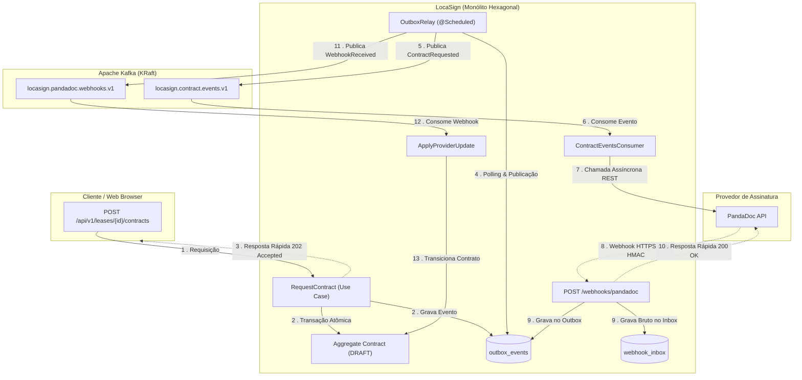
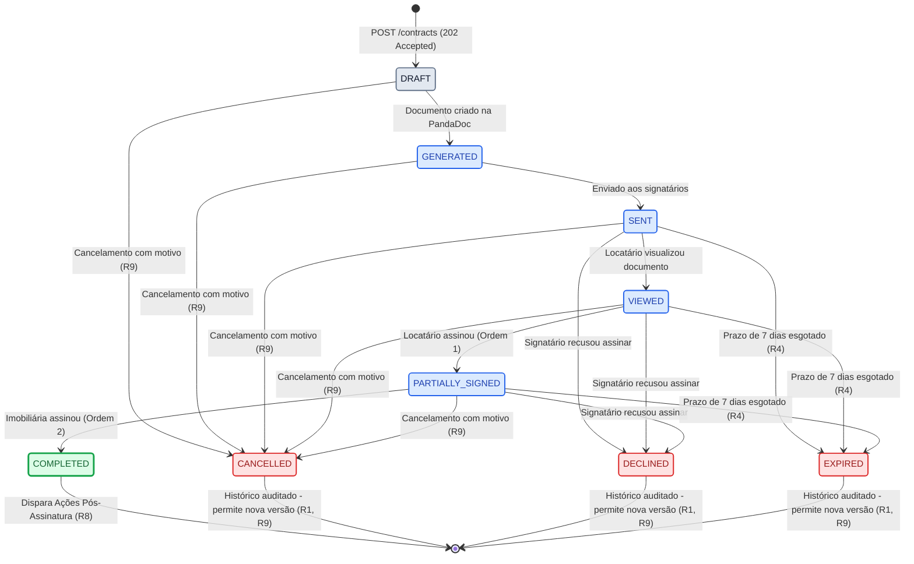
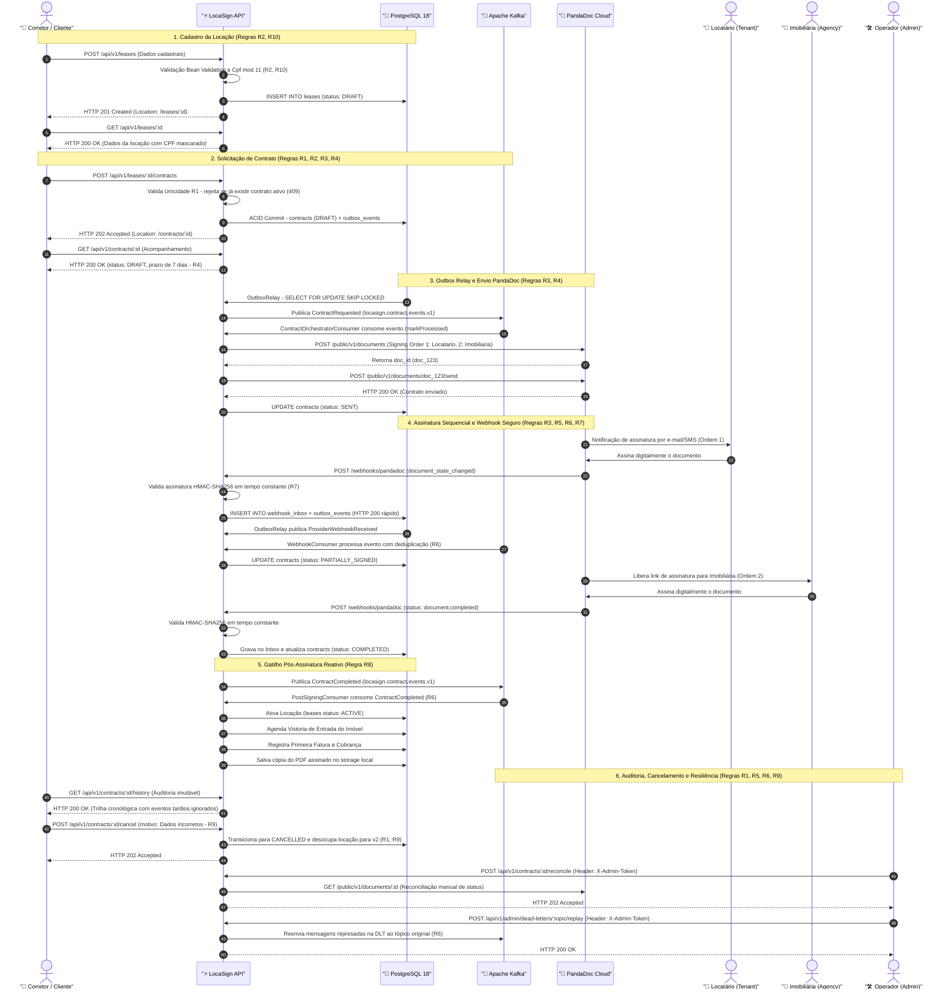

# LocaSign

[](https://kotlinlang.org)
[](https://adoptium.net)
[](https://spring.io/projects/spring-boot)
[](https://www.postgresql.org)
[](https://kafka.apache.org)
[](https://gradle.org)
[](docs/adr/0014-estrategia-e-ferramentas-de-testes.md)

Serviço backend de alto desempenho e resiliência que automatiza integralmente o ciclo de vida de contratos de **locação
residencial**: cadastra a locação, orquestra a geração do contrato, envia para assinatura eletrônica na **PandaDoc**,
acompanha cada etapa por **webhooks assíncronos com idempotência estrita** e dispara sozinho as ações
pós-assinatura (ativação da locação, agendamento de vistoria, emissão da primeira cobrança e notificações simuladas).

> **Propósito do repositório:** projeto de estudo de engenharia de software pragmática com Kotlin, Spring Boot,
> PostgreSQL, Apache Kafka e Docker.  
> As regras de negócio canônicas (**R1 a R10**) residem em [`docs/plano-de-negocio.md`](docs/plano-de-negocio.md), e o
> desenho
> de engenharia em [`docs/arquitetura-tecnica.md`](docs/arquitetura-tecnica.md). Decisões de design posteriores ao guia
> ficam
> registradas em [`docs/adr/`](docs/adr/). As diretrizes de desenvolvimento e governança estão em [
`AGENTS.md`](AGENTS.md) e
> [`docs/agents/`](docs/agents/). Utilize exclusivamente **dados fictícios** (R10).

---

## Sumário

1. [Regras de Negócio Fundamentais (R1 a R10)](#1-regras-de-negócio-fundamentais-r1-a-r10)
2. [Pilha Tecnológica Fixada](#2-pilha-tecnológica-fixada)
3. [Arquitetura e Fluxo Orientado a Eventos](#3-arquitetura-e-fluxo-orientado-a-eventos)
4. [Ciclo de Vida do Contrato (Máquina de Estados)](#4-ciclo-de-vida-do-contrato-máquina-de-estados)
5. [Coleção Bruno: Demonstração Interativa por Jornadas](#5-coleção-bruno-demonstração-interativa-por-jornadas)
6. [Catálogo de Endpoints e Problem Details (RFC 9457)](#6-catálogo-de-endpoints-e-problem-details-rfc-9457)
7. [Executando o Ambiente Local](#7-executando-o-ambiente-local)
8. [Variáveis de Ambiente e Configuração](#8-variáveis-de-ambiente-e-configuração)
9. [Preparando a PandaDoc (Checklist do Dia 1)](#9-preparando-a-pandadoc-checklist-do-dia-1)
10. [Estratégia e Pirâmide de Testes (234 Testes)](#10-estratégia-e-pirâmide-de-testes-234-testes)
11. [Estrutura do Projeto e Decisões Arquiteturais (ADRs)](#11-estrutura-do-projeto-e-decisões-arquiteturais-adrs)
12. [Resiliência, Operação e Troubleshooting](#12-resiliência-operação-e-troubleshooting)

---

## 1. Regras de Negócio Fundamentais (R1 a R10)

> [!IMPORTANT]
> **Precedência Canônica:** As regras **R1 a R10** ([`docs/plano-de-negocio.md`](docs/plano-de-negocio.md) §8)
constituem os invariantes absolutos de negócio da aplicação e prevalecem rigorosamente sobre qualquer ADR, princípio de
design ou detalhe de infraestrutura.

### 1.1 Invariantes Estruturais e de Negócio (R1 a R5)

|                                           Regra                                           | Invariante Mandatório                                                                                                                                               | Consequência Técnica no Sistema                                                                                 |                            Resposta HTTP (RFC 9457)                             |
|:-----------------------------------------------------------------------------------------:|:--------------------------------------------------------------------------------------------------------------------------------------------------------------------|:----------------------------------------------------------------------------------------------------------------|:-------------------------------------------------------------------------------:|
|                  | **Unicidade de Contrato Ativo**<br>Uma locação só pode ter 1 contrato em estado não terminal por vez.                                                               | Bloqueio atômico via índice parcial único no PostgreSQL (`WHERE status NOT IN (...)`).                          |            `HTTP 409 Conflict`<br>`/problems/active-contract-exists`            |
|  | **Dados Obrigatórios da Locação**<br>Locatário com CPF válido (algoritmo mod 11), endereço, aluguel positivo (> 0), data presente/futura e prazo (1 a 120 meses).   | Validação defensiva no construtor do agregado e Bean Validation nos controllers.                                | `HTTP 422 Unprocessable`<br>`/problems/business-rule`<br>`HTTP 400 Bad Request` |
|    | **Ordem Sequencial de Assinatura**<br>Primeiro assina o Locatário (`Tenant`, ordem 1); somente após a conclusão dele, a Imobiliária (`Agency`, ordem 2) é acionada. | Orquestrado na PandaDoc via signing order sequencial com papéis dedicados. Previne minutas assinadas em branco. |                   `HTTP 200 OK`<br>`(PandaDoc Signing Order)`                   |
|        | **Prazos e Lembretes Automáticos**<br>Prazo máximo de 7 dias para assinatura, com lembrete automático disparado no 3º dia.                                          | Jobs agendados `@Scheduled` (`ExpirationJob` e `ReminderJob`) operando sobre o `BusinessClock`.                 |                       `HTTP 200 OK`<br>`(Job Automático)`                       |
|              | **Imutabilidade e Não Regressão**<br>O status nunca regride. Estados finais (`COMPLETED`, `CANCELLED`, `DECLINED`, `EXPIRED`) são estritamente imutáveis.           | `ContractTransitionPolicy` rejeita transições retrógradas. Webhooks atrasados geram `IGNORED_TRANSITION`.       |                `HTTP 409 Conflict`<br>`/problems/contract-final`                |

### 1.2 Garantias Técnicas, Idempotência e LGPD (R6 a R10)

|                                            Regra                                            | Invariante Mandatório                                                                                                                                   | Consequência Técnica no Sistema                                                                             |            Resposta HTTP (RFC 9457)            |
|:-------------------------------------------------------------------------------------------:|:--------------------------------------------------------------------------------------------------------------------------------------------------------|:------------------------------------------------------------------------------------------------------------|:----------------------------------------------:|
|            | **Idempotência Estrita**<br>A recepção repetida do mesmo evento ou webhook nunca produz efeito colateral duplicado.                                     | Consumidores Kafka com controle atômico de deduplicação via `ProcessedMessagesPort.markProcessed(eventId)`. |      `HTTP 200 OK`<br>`(Skip Silencioso)`      |
|   | **Gravação Bruta no Inbox**<br>Todo webhook da PandaDoc é gravado bruto no banco antes de qualquer processamento de negócio.                            | Persistência atômica em `webhook_inbox` + `outbox_events` devolvendo resposta ultrarrápida (< 30ms).        |     `HTTP 200 OK`<br>`(Gravação Imediata)`     |
|         | **Gatilho das Ações Pós-Assinatura**<br>Ativação da locação, vistoria de entrada e primeira fatura só ocorrem quando o contrato alcança `COMPLETED`.    | `PostSigningConsumer` escutando Kafka acionado estritamente pela chegada do evento `ContractCompleted`.     |       `HTTP 200 OK`<br>`(Reação Kafka)`        |
|      | **Correção de Contrato com Nova Versão**<br>Alterações após o envio exigem cancelamento formal com motivo registrado e emissão de nova versão (v2, v3). | O contrato atual transiciona para `CANCELLED` (histórico preservado) e um novo `DRAFT` é gerado na locação. |     `HTTP 200 OK`<br>`(Trilha Auditável)`      |
|  | **Proteção de Dados Pessoais (LGPD)**<br>Uso exclusivo de dados fictícios. CPF e e-mail nunca podem ser logados ou expostos abertos.                    | Value objects seguros com mascaramento nativo: `Cpf.masked()` e `Email.masked()` aplicados em logs e DTOs.  | `Conformidade Legal`<br>`(toString Mascarado)` |

---

## 2. Pilha Tecnológica Fixada

A stack técnica é estritamente fixada e controlada via Version Catalog (`gradle/libs.versions.toml`) e BOM gerenciado:

| Tecnologia ou Área           | Versão / Configuração           | Papel e Justificativa de Engenharia                                               |
|------------------------------|---------------------------------|-----------------------------------------------------------------------------------|
| **Linguagem**                | Kotlin `2.4.21`                 | Null-safety nativa, `sealed classes` exaustivas e imutabilidade de domínio.       |
| **Plataforma / JVM**         | Java `25 LTS` (Eclipse Temurin) | Toolchain fixada, compilação moderna e execução de alta performance.              |
| **Framework Base**           | Spring Boot `4.1.1`             | Spring Framework 7.0.7, Jackson 3 e inicialização otimizada sem `open` classes.   |
| **Persistência Relacional**  | PostgreSQL `18.6`               | Spring Data JDBC e `JdbcClient` (SQL explícito, sem sobrecarga de JPA/Hibernate). |
| **Mensageria Distribuída**   | Apache Kafka `4.3.1` (KRaft)    | Broker em modo KRaft (sem ZooKeeper) e biblioteca cliente `kafka-clients` 4.2.    |
| **Automação de Build**       | Gradle `9.8.1`                  | Build determinístico, checagem de warnings (`-Werror`) e geração de `app.jar`.    |
| **Testes de Integração**     | Testcontainers `1.20.6`         | Subida real de instâncias de PostgreSQL e Kafka para validação rigorosa.          |
| **Mocking de APIs Externas** | WireMock `3.13.2` (ADR-014)     | Isolamento completo da API da PandaDoc com testes de rate limit e resiliência.    |
| **Arquitetura Estática**     | ArchUnit `1.5.1` (ADR-014)      | Validação automatizada contínua das 13 regras do monólito modular hexagonal.      |
| **Containers**               | Docker / Compose v5+            | Ambientes padronizados para desenvolvimento local e pipelines de CI.              |

---

## 3. Arquitetura e Fluxo Orientado a Eventos

O sistema foi concebido como um **monólito modular hexagonal** (`shared`, `lease`, `contract`, `notification`). Chamadas
externas síncronas são terminantemente proibidas no ciclo de vida de requisições do usuário: todas as integrações com a
PandaDoc são executadas de maneira assíncrona orientada a eventos através dos padrões **Transactional Outbox** e
**Inbox**.



---

## 4. Ciclo de Vida do Contrato (Máquina de Estados)

O ciclo de vida do contrato residencial é governado pelo agregado `Contract` e pela política determinística centralizada
`ContractTransitionPolicy` (Kotlin puro, sem dependências de infraestrutura). Conforme a regra **R5**, o status nunca
regride e estados terminais são absolutamente imutáveis.

### 4.1 Pipeline Linear de Progressão de Estados

```
[DRAFT] ➔ [GENERATED] ➔ [SENT] ➔ [VIEWED] ➔ [PARTIALLY_SIGNED] ➔ [COMPLETED] 🏆
   │           │           │        │               │
   ▼           ▼           ▼        ▼               ▼
[CANCELLED] [CANCELLED] [CANCELLED, [CANCELLED, [CANCELLED,
                        DECLINED,   DECLINED,   DECLINED,
                        EXPIRED]    EXPIRED]    EXPIRED]
```

### 4.2 Diagrama de Estados do Domínio



### 4.3 Matriz de Estados e Políticas de Transição

| Categoria              | Estados                                                           | Comportamento e Regras de Negócio                                                                                                                                                                             |
|:-----------------------|:------------------------------------------------------------------|:--------------------------------------------------------------------------------------------------------------------------------------------------------------------------------------------------------------|
| **Em Andamento**       | `DRAFT`, `GENERATED`, `SENT`, `VIEWED`, `PARTIALLY_SIGNED`        | Aceitam transições estritamente progressivas (avanço monotônico de progresso ordinal).                                                                                                                        |
| **Terminais Estritos** | `COMPLETED` 🏆<br>`CANCELLED` 🚫<br>`DECLINED` ❌<br>`EXPIRED` ⏰ | **Estritamente imutáveis (R5):** Não aceitam nenhuma mutação subsequente. Tentativas via API devolvem `HTTP 409 Conflict` (`/problems/contract-final`).                                                       |
| **Eventos Tardios**    | Webhooks desordenados na rede (ex: `VIEWED` após `COMPLETED`)     | **Tratamento Defensivo:** Em vez de quebrar a transação com erro 500 ou regredir o status, a política sinaliza `IGNORED_TRANSITION`. O evento é registrado na auditoria mas o estado final permanece intacto. |

```kotlin
// ContractTransitionPolicy.kt — Decisão Determinística sem Frameworks
object ContractTransitionPolicy {
    fun decide(current: ContractStatus, target: ContractStatus): TransitionDecision = when {
        current == target -> TransitionDecision.NoOp
        current.isFinal -> TransitionDecision.Reject("Contrato em estado final ($current) é imutável.")
        target.isFinal || target.progress > current.progress -> TransitionDecision.Apply
        else -> TransitionDecision.Reject("A transição $current -> $target regrediria o status.")
    }
}
```

> [!NOTE]
> **Saltos para Frente (ADR-010):** Como a PandaDoc não garante a retransmissão de webhooks intermediários perdidos na
internet, transições diretas com saltos (ex.: de `SENT` diretamente para `COMPLETED`) são formalmente autorizadas para
garantir a convergência do estado real.

---

## 5. Coleção Bruno: Demonstração Interativa por Jornadas

O repositório disponibiliza uma coleção completa e pronta para importação no cliente de APIs **Bruno** (padrão
OpenCollection
YAML) em [`http/demonstracao-do-plano-de-negocio`](http/demonstracao-do-plano-de-negocio):

```text
http/demonstracao-do-plano-de-negocio/
├── opencollection.yml                             # Metadados e variáveis globais da coleção
├── collection.bru                                 # Documentação unificada para o cliente Bruno
├── README.md                                      # Guia detalhado de uso e roteiro da coleção
├── environments/
│   └── Local.yml                                  # Ambiente Local (baseUrl: http://localhost:8080)
├── 01-fluxo-feliz/                                # 📁 01 - Fluxo Feliz (Ponta a Ponta) (8 requisições)
├── 02-cenarios-de-erro/                           # 📁 02 - Cenários de Erro e Regras de Negócio (13 requisições)
├── 03-operacao-e-resiliencia/                     # 📁 03 - Operação e Resiliência (6 requisições)
└── 04-infraestrutura-e-observabilidade/           # 📁 04 - Infraestrutura e Observabilidade (4 requisições)
```

### Principais Benefícios da Coleção

1. **Organização Visual em 4 Pastas:** Permite testar o fluxo feliz do início ao fim sem poluição de erros, ou auditar
   exclusivamente a robustez defensiva da aplicação.
2. **Automação Pós-Resposta de Variáveis:** As requisições de sucesso (`01-cadastra-locacao`, `03-solicita-contrato` e
   `08-solicita-nova-versao`) extraem e definem automaticamente as variáveis `leaseId` e `contractId`, permitindo
   execução
   contínua sem cópia e cola manual.
3. **Isolamento de Erros:** As requisições de teste de erro `404` utilizam identificadores nulos deliberados
   (`00000000-0000-0000-0000-000000000000`), garantindo que não sobrescrevam as variáveis do contrato em teste.
4. **Comandos cURL Embutidos:** Cada um dos 31 arquivos `.yml` possui um bloco `docs` com o comando `curl` equivalente
   pronto para execução direta no terminal.

Consulte o [**Guia Completo da Coleção**](http/demonstracao-do-plano-de-negocio/README.md) para o roteiro detalhado.

---

## 6. Catálogo de Endpoints e Problem Details (RFC 9457)

### 6.1 Endpoints REST da Aplicação

| Método | Caminho                                     |      Perfil de Acesso      | Descrição e Status Esperado                                            |
|--------|---------------------------------------------|:--------------------------:|------------------------------------------------------------------------|
| `POST` | `/api/v1/leases`                            |          Público           | Cadastra nova locação residencial (`201 Created`).                     |
| `GET`  | `/api/v1/leases/{id}`                       |          Público           | Consulta detalhes da locação e contrato ativo (`200 OK`).              |
| `POST` | `/api/v1/leases/{id}/contracts`             |          Público           | Solicita confecção do contrato ou nova versão (`202 Accepted`).        |
| `GET`  | `/api/v1/contracts/{id}`                    |          Público           | Consulta status atual, signatários e prazos (`200 OK`).                |
| `GET`  | `/api/v1/contracts/{id}/history`            |          Público           | Linha do tempo cronológica com trilha de auditoria (`200 OK`).         |
| `POST` | `/api/v1/contracts/{id}/cancel`             |          Público           | Cancelamento formal de contrato com justificativa (`202 Accepted`).    |
| `POST` | `/webhooks/pandadoc`                        |          PandaDoc          | Ingestão de webhooks assinado via HMAC-SHA256 (`200 OK`).              |
| `POST` | `/api/v1/contracts/{id}/reconcile`          | Operador (`X-Admin-Token`) | Força reconciliação manual com a API da PandaDoc (`202 Accepted`).     |
| `POST` | `/api/v1/admin/dead-letters/{topic}/replay` | Operador (`X-Admin-Token`) | Reenvia mensagens represadas na DLT para o tópico original (`200 OK`). |
| `GET`  | `/actuator/health`                          |          Público           | Health check consolidado de banco e broker Kafka (`200 OK`).           |
| `GET`  | `/actuator/metrics/locasign.*`              |          Público           | Métricas dimensionais Micrometer de transições e webhooks (`200 OK`).  |
| `GET`  | `/v3/api-docs` / `/swagger-ui.html`         |          Público           | Especificação OpenAPI 3.1 e documentação interativa Swagger.           |

<details>
<summary>🔍 <b>Clique aqui para expandir o Diagrama de Sequência Ponta a Ponta e a Legenda das Regras por Endpoint</b></summary>
<br>

#### Diagrama de Sequência: Ciclo de Vida Completo da Locação e Contrato



---

#### Legenda das Regras de Negócio e Comportamento por Endpoint

| Método | Caminho                                     | Regras de Negócio Aplicadas | Comportamento de Domínio e Validações                                                                                                                                                                                                                                                                                                                                                                                                                                       | Respostas Típicas (RFC 9457)                                                                                                       |
|:------:|:--------------------------------------------|:---------------------------:|:----------------------------------------------------------------------------------------------------------------------------------------------------------------------------------------------------------------------------------------------------------------------------------------------------------------------------------------------------------------------------------------------------------------------------------------------------------------------------|:-----------------------------------------------------------------------------------------------------------------------------------|
| `POST` | `/api/v1/leases`                            |         **R2, R10**         | Cadastra a locação residencial em estado `DRAFT`. Valida Bean Validation (`@NotNull`, `@NotBlank`, `@Positive`) e invariantes no value object `Cpf` (algoritmo módulo 11), `Email` (RFC 5322), aluguel positivo e prazo de 1 a 120 meses. Garante mascaramento estrito de dados pessoais em logs e DTOs.                                                                                                                                                                    | `201 Created` (`Location: /leases/{id}`)<br>`400 Bad Request` (campos ausentes)<br>`422 Unprocessable` (`/problems/business-rule`) |
| `GET`  | `/api/v1/leases/{id}`                       |         **R1, R10**         | Consulta os dados cadastrais da locação e projeta o contrato ativo associado (se houver). Comprova que no máximo 1 contrato não terminal pode coexistir na mesma locação. Retorna os dados com o CPF do locatário mascarado (`Cpf.masked()`).                                                                                                                                                                                                                               | `200 OK`<br>`404 Not Found` (`/problems/not-found`)                                                                                |
| `POST` | `/api/v1/leases/{id}/contracts`             |     **R1, R2, R3, R4**      | Ponto de partida do ciclo de vida contratual. Consulta a locação e **valida a Regra R1**: se já existir contrato não terminal, rejeita imediatamente com `HTTP 409 Conflict`. Agregado nasce em `DRAFT`, define prazo de 7 dias (R4), estabelece a ordem sequencial de assinatura (R3) e grava atomicamente o estado e o evento em `outbox_events` no PostgreSQL 18.                                                                                                        | `202 Accepted` (`Location: /contracts/{id}`)<br>`404 Not Found`<br>`409 Conflict` (`/problems/active-contract-exists`)             |
| `GET`  | `/api/v1/contracts/{id}`                    |     **R3, R4, R5, R10**     | Consulta o estado atual da máquina de estados (`DRAFT` a `COMPLETED`), os signatários associados com suas respectivas ordens de assinatura (1: Locatário, 2: Imobiliária) e o prazo limite de expiração calculado pelo `BusinessClock`. Dados pessoais saem estritamente mascarados.                                                                                                                                                                                        | `200 OK`<br>`404 Not Found` (`/problems/not-found`)                                                                                |
| `GET`  | `/api/v1/contracts/{id}/history`            |         **R5, R10**         | Linha do tempo cronológica com trilha de auditoria completa e imutável. Exibe cada transição de status com timestamp exato, autor/origem (`API`, `PANDADOC`, `JOB`) e registra eventuais webhooks atrasados ignorados pela política defensiva (`IGNORED_TRANSITION`).                                                                                                                                                                                                       | `200 OK`<br>`404 Not Found` (`/problems/not-found`)                                                                                |
| `POST` | `/api/v1/contracts/{id}/cancel`             |       **R1, R5, R9**        | Cancelamento formal de contrato com justificativa obrigatória (`reason`). Se o contrato já estiver em estado final (`COMPLETED`, `CANCELLED`, `DECLINED`, `EXPIRED`), rejeita com `HTTP 409 Conflict` (R5). Se válido, transiciona para `CANCELLED`, preserva o histórico e desocupa a locação, viabilizando a emissão de uma nova versão v2/v3 (R1, R9).                                                                                                                   | `202 Accepted`<br>`400 Bad Request` (sem motivo)<br>`404 Not Found`<br>`409 Conflict` (`/problems/contract-final`)                 |
| `POST` | `/webhooks/pandadoc`                        |   **R3, R5, R6, R7, R8**    | Receptor HTTP assíncrono para eventos da PandaDoc. Valida a assinatura HMAC-SHA256 sobre bytes brutos em tempo constante (`MessageDigest.isEqual`). Se inválido, rejeita prontamente com `HTTP 401 Unauthorized`. Se válido, grava bruto atômico em `webhook_inbox` + `outbox_events` e devolve `HTTP 200 OK` rápido (< 30ms - R7). O consumidor Kafka subsequente deduplica a mensagem (R6), aplica a transição segura (R5) e aciona o pós-assinatura em `COMPLETED` (R8). | `200 OK` (gravação imediata)<br>`401 Unauthorized` (HMAC inválido)                                                                 |
| `POST` | `/api/v1/contracts/{id}/reconcile`          |       **R3, R5, R6**        | Rota de suporte operacional protegida pelo header `X-Admin-Token`. Força consulta síncrona à API da PandaDoc (`GET /public/v1/documents/{id}`) para reconciliar o status do contrato caso algum webhook tenha sido perdido na internet. Aplica a transição via `ContractTransitionPolicy` com idempotência estrita.                                                                                                                                                         | `202 Accepted`<br>`401 Unauthorized` (token inválido/ausente)<br>`404 Not Found` (`/problems/not-found`)                           |
| `POST` | `/api/v1/admin/dead-letters/{topic}/replay` |           **R6**            | Rota de resiliência protegida por `X-Admin-Token`. Permite ao operador reenviar mensagens represadas no tópico de dead-letter (`.dlt`) de volta ao tópico Kafka original. Graças à idempotência estrita (R6), mensagens que já haviam sido processadas com sucesso são descartadas pelos consumidores sem efeitos colaterais duplicados.                                                                                                                                    | `200 OK`<br>`401 Unauthorized` (token ausente/inválido)<br>`400 Bad Request` (tópico inválido)                                     |

</details>

### 6.2 Mapeamento de Erros Determinísticos (RFC 9457)

Em conformidade com a RFC 9457 (Problem Details for HTTP APIs), todas as falhas de validação e violações de regras de
negócio
retornam payloads JSON padronizados:

|     Código HTTP     | Tipo (`type`)                      | Descrição da Ocorrência                                                       |
|:-------------------:|------------------------------------|-------------------------------------------------------------------------------|
|  `400 Bad Request`  | `/problems/validation`             | Campos obrigatórios ausentes, parâmetros malformados ou justificativa vazia.  |
| `401 Unauthorized`  | —                                  | Assinatura HMAC-SHA256 ausente ou inválida no webhook (nunca devolve 410).    |
|   `403 Forbidden`   | —                                  | Tentativa de acesso a rotas operacionais sem o cabeçalho `X-Admin-Token`.     |
|   `404 Not Found`   | `/problems/not-found`              | Locação, contrato ou tópico de mensageria inexistente no sistema.             |
|   `409 Conflict`    | `/problems/active-contract-exists` | Tentativa de solicitar novo contrato para locação com contrato ativo (R1).    |
|   `409 Conflict`    | `/problems/contract-final`         | Tentativa de alterar contrato em estado terminal imutável (R5).               |
| `422 Unprocessable` | `/problems/business-rule`          | Violação de regra de domínio (CPF inválido, data passada, aluguel <= 0) (R2). |

---

## 7. Executando o Ambiente Local

### Pré-requisitos

- **Java 25 LTS** instalado no sistema operacional (Eclipse Temurin recomendado).
- **Docker** ou **Rancher Desktop** ativo (com suporte a Docker Compose).

### 7.1 Execução Híbrida (Infraestrutura em Containers + App no Host)

Este é o modo mais ágil para desenvolvimento diário:

#### No Windows (PowerShell):

```powershell
# 1. Sobe PostgreSQL 18.6 e Apache Kafka 4.3.1 (KRaft) em segundo plano
docker compose up -d

# 2. Define as variáveis recomendadas para o ambiente local (webhook e token admin)
$env:PANDADOC_WEBHOOK_SHARED_KEY = "segredo"
$env:ADMIN_TOKEN = "abc123"

# 3. Executa a aplicação Spring Boot com perfil local
.\gradlew.bat bootRun --args="--spring.profiles.active=local"
```

#### No Linux / macOS (Bash):

```bash
# 1. Sobe PostgreSQL 18.6 e Apache Kafka 4.3.1 (KRaft) em segundo plano
docker compose up -d

# 2. Define as variáveis recomendadas para o ambiente local (webhook e token admin)
export PANDADOC_WEBHOOK_SHARED_KEY="segredo"
export ADMIN_TOKEN="abc123"

# 3. Executa a aplicação Spring Boot com perfil local
./gradlew bootRun --args='--spring.profiles.active=local'
```

Acesse no navegador:

- **Health Check:** [http://localhost:8080/actuator/health](http://localhost:8080/actuator/health) (banco e Kafka devem
  estar `UP`)
- **Swagger UI:** [http://localhost:8080/swagger-ui.html](http://localhost:8080/swagger-ui.html)

---

### 7.2 Execução Totalmente Conteinerizada

Para subir todos os componentes (banco, broker e a aplicação compilada em container) em um único comando:

```bash
docker compose --profile app up -d --build
```

---

### 7.3 Perfis Opcionais do Compose

O arquivo [`compose.yml`](compose.yml) possui perfis modulares adicionais:

- **Kafka UI (Interface Web de Mensageria):**
  ```bash
  docker compose --profile tools up -d
  ```
  Acesse o painel em [http://localhost:8081](http://localhost:8081) para inspecionar tópicos, offsets e mensagens de
  DLT.

- **Túnel HTTPS Público para Webhooks (Cloudflare):**
  ```bash
  docker compose --profile tunnel up -d
  docker compose logs tunnel  # exibe a URL pública HTTPS gerada
  ```

- **Encerrando os Containers com Segurança:**
  ```bash
  # Encerra os serviços mantendo os volumes persistidos
  docker compose down

  # CUIDADO: o comando abaixo apaga banco de dados e mensagens do Kafka!
  # docker compose down -v
  ```

---

### 7.4 Roteiro de Teste Ponta a Ponta: Da Criação à Finalização com Assinatura (Regra R8)

Para validar localmente todo o ciclo de vida sem depender de uma conta externa da PandaDoc, utilize o roteiro abaixo com
a coleção **Bruno** ou scripts de terminal:

#### 1. No Bruno (ou via cURL)

1. **Ative o ambiente `Local`** no canto superior direito do Bruno (define `baseUrl = http://localhost:8080`).
2. **Execute `01 - Cadastra a locação`:** responde `201 Created` e armazena o `leaseId`.
3. **Execute `02 - Consulta a locação`:** status inicial `REGISTERED`.
4. **Execute `03 - Solicita o contrato`:** responde `202 Accepted` e armazena o `contractId` (status inicial `DRAFT`).
5. **Execute `04 - Acompanha o status`:** confirma contrato em `DRAFT`.

#### 2. Disparo da Assinatura Completa via Webhook Assinado (HMAC-SHA256)

Por segurança e conformidade (Regra **R7** e ADR-012), a aplicação exige validação criptográfica HMAC no endpoint
`/webhooks/pandadoc?signature=...`.

- **Pelo Bruno:** abra `01 - Fluxo Feliz / 06 - Webhook PandaDoc`, altere no JSON `"status": "document.viewed"` para
  `"status": "document.completed"` e defina `"has_completed": true`. O script *Pre-Request* calcula o HMAC
  automaticamente utilizando a chave configurada (`segredo`) e envia com sucesso (`200 OK`).
- **Pelo PowerShell no Windows (Script Rápido):**
  ```powershell
  $contractId = "COLE_AQUI_O_CONTRACT_ID"
  $secret = "segredo"
  $payload = @"
  [{"event":"document_state_changed","data":{"id":"doc_123","date_modified":"$([System.DateTime]::UtcNow.ToString('o'))","status":"document.completed","metadata":{"contract_id":"$contractId"},"recipients":[{"email":"maria@example.com","role":"Locatario","has_completed":true},{"email":"alianca@example.com","role":"Imobiliaria","has_completed":true}]}}]
  "@
  $bytes = [System.Text.Encoding]::UTF8.GetBytes($payload)
  $hmac = New-Object System.Security.Cryptography.HMACSHA256
  $hmac.Key = [System.Text.Encoding]::UTF8.GetBytes($secret)
  $sig = [System.BitConverter]::ToString($hmac.ComputeHash($bytes)).Replace('-', '').ToLower()
  Invoke-RestMethod -Uri "http://localhost:8080/webhooks/pandadoc?signature=$sig" -Method Post -Headers @{"Content-Type"="application/json";"X-PandaDoc-Webhook-Event-Id"=[System.Guid]::NewGuid().ToString()} -Body $bytes
  ```
- **Pelo Bash no Linux/WSL2:**
  ```bash
  PANDADOC_WEBHOOK_SHARED_KEY=segredo bash scripts/send-signed-webhook.sh scripts/samples/document-state-changed.json
  ```

#### 3. Verificação dos Efeitos Pós-Assinatura (Regra R8)

1. **Contrato:** ao consultar novamente (`GET /api/v1/contracts/{{contractId}}`), o status estará **`COMPLETED`**.
2. **Histórico:** `GET /api/v1/contracts/{{contractId}}/history` exibe toda a trilha de auditoria gravada.
3. **Locação Ativada:** `GET /api/v1/leases/{{leaseId}}` mostra que o status da locação mudou sozinho para **`ACTIVE`**,
   com `activatedAt` devidamente preenchido.
4. **Efeitos Pós-Assinatura:** as tabelas `post_signature_actions` (vistoria e primeira cobrança) e `notifications_log`
   são registradas de forma assíncrona via consumidores Kafka.

---

## 8. Variáveis de Ambiente e Configuração

Defina as variáveis no ambiente ou em um arquivo `.env` na raiz do projeto (nunca versione o `.env`). A aplicação inicia
mesmo sem as credenciais da PandaDoc, permitindo testar cadastros e o fluxo local:

| Variável                           | Padrão                                      | Descrição e Impacto                                                                 |
|------------------------------------|---------------------------------------------|-------------------------------------------------------------------------------------|
| `DB_URL`                           | `jdbc:postgresql://localhost:5432/locasign` | URL de conexão JDBC ao PostgreSQL.                                                  |
| `DB_USERNAME` / `DB_PASSWORD`      | `locasign` / `locasign`                     | Credenciais do banco de dados relacional.                                           |
| `KAFKA_BOOTSTRAP_SERVERS`          | `localhost:9092`                            | Endereço do broker Kafka (`kafka:29092` na rede interna do Compose).                |
| `PANDADOC_API_KEY`                 | *(vazio)*                                   | Chave de API da PandaDoc (utilize chave **sandbox** no desenvolvimento).            |
| `PANDADOC_TEMPLATE_ID`             | *(vazio)*                                   | UUID do modelo de contrato configurado no painel da PandaDoc.                       |
| `PANDADOC_WEBHOOK_SHARED_KEY`      | *(vazio)*                                   | Chave secreta compartilhada para cálculo do HMAC-SHA256 dos webhooks.               |
| `PANDADOC_BASE_URL`                | `https://api.pandadoc.com/public/v1`        | URL base da API REST da PandaDoc.                                                   |
| `PANDADOC_DOWNLOAD_ENABLED`        | `false`                                     | Se `true`, realiza o download do PDF assinado (exige chave de produção).            |
| `PANDADOC_RATE_LIMIT_PER_MINUTE`   | `8`                                         | Limite defensivo por minuto (abaixo do teto de 10/min do sandbox).                  |
| `AGENCY_SIGNER_NAME` / `_EMAIL`    | *(vazio)*                                   | Nome e e-mail padrão do representante da imobiliária (signatário 2).                |
| `CONTRACT_SIGNATURE_DEADLINE_DAYS` | `7`                                         | Prazo limite em dias para conclusão das assinaturas (R4).                           |
| `APP_TIMEZONE`                     | `America/Sao_Paulo`                         | Fuso horário canônico para cálculos de datas de vigência e prazos.                  |
| `ADMIN_TOKEN`                      | *(vazio)*                                   | Habilita operações sensíveis via cabeçalho `X-Admin-Token`. Vazio desabilita (403). |
| `ARCHIVE_DIRECTORY`                | `./data/signed-documents`                   | Diretório local de armazenamento dos documentos PDFs concluídos.                    |

---

## 9. Preparando a PandaDoc (Checklist do Dia 1)

1. Crie uma conta na **PandaDoc** (o plano de avaliação inclui sandbox e produção).
2. Em *Settings → API and Integrations*, ative o acesso à API e gere uma chave de **Sandbox**.
3. Crie um modelo de contrato com os papéis de signatário exatos: **`Locatario`** e **`Imobiliaria`**.
4. Configure no modelo os tokens de preenchimento automático:
    - `[Locatario.Nome]`, `[Locatario.CPF]`, `[Imovel.Endereco]`, `[Aluguel.Valor]`, `[Locacao.Inicio]`,
      `[Locacao.Prazo]`.
5. Copie o UUID do modelo e configure na variável `PANDADOC_TEMPLATE_ID`.
6. Suba o túnel HTTPS (`docker compose --profile tunnel up -d`, confira a URL gerada com `docker compose logs tunnel`)
   e registre o webhook para a URL `https://<url-do-tunel>/webhooks/pandadoc` com os eventos:
    - `document_state_changed`, `recipient_completed`, `document_creation_failed`, `document_completed_pdf_ready` e
      `document_deleted`.
7. Copie a chave secreta compartilhada e preencha em `PANDADOC_WEBHOOK_SHARED_KEY`.

---

## 10. Estratégia e Pirâmide de Testes (234 Testes)

A aplicação conta com uma esteira rigorosa de **234 testes automatizados com 100% de aprovação**, cobrindo todas as
camadas
da arquitetura hexagonal (formalizada no [ADR-014](docs/adr/0014-estrategia-e-ferramentas-de-testes.md)):

```text
              ▲
             / \
            /E2E\             LocaSignE2EIT (1 teste)
           /-----\            Fluxo assíncrono completo: REST ➔ Outbox ➔ Kafka ➔ WireMock ➔ Webhook ➔ Ativação
          /  IT   \
         /---------\          Testcontainers (PostgreSQL 18.6 + Kafka 4.3.1 KRaft) (19 testes)
        / WireMock  \         Persistência real, índices parciais (R1), outbox, inbox e idempotência (R6, R7, R8)
       /-------------\
      /   ArchUnit    \       PandaDocSignatureProviderAdapterTest e PandaDocErrorsTest (20 testes)
     /-----------------\      Contratos REST, resiliência HTTP/1.1, rate limit 429, backoff e tradução de erros
    /     Web Slices    \
   /---------------------\    HexagonalArchitectureTest (13 testes)
  /   Unitários de Domínio\   Fronteiras arquiteturais do AGENTS.md §5 (docs/agents/arquitetura.md §6)
 /_________________________\
                              @WebMvcTest com MockMvcTester (27 testes)
                              Validação Jakarta Bean Validation, RFC 9457 Problem Details e segurança do operador

                              Domínio e Aplicação Puros (154 testes)
                              Agregados Contract e Lease, políticas de transição (R5), value objects (Cpf, Email, Money)
```

### Comandos de Execução da Suíte

```bash
# Executa apenas os testes rápidos que não necessitam de Docker (unitários, fatias web, wiremock e archunit)
.\gradlew.bat test --tests "*Test" --console=plain        # Windows PowerShell
./gradlew test --tests "*Test" --console=plain          # Linux / macOS

# Executa todos os testes (incluindo testes de integração *IT via Testcontainers; exige Docker ativo)
.\gradlew.bat test --console=plain                      # Windows PowerShell
./gradlew test --console=plain                          # Linux / macOS

# Gate completo de qualidade da CI (compilação sem warnings, testes e geração do build/libs/app.jar)
.\gradlew.bat build --console=plain                     # Windows PowerShell
./gradlew build --console=plain                         # Linux / macOS
```

---

## 11. Estrutura do Projeto e Decisões Arquiteturais (ADRs)

### 11.1 Árvore Modular Hexagonal

```text
src/main/kotlin/br/com/locasign/
├── shared/         # Transversal: value objects (Cpf, Email, Money), inbox, outbox, DLT, Time
├── lease/          # Módulo de locação (cadastro, consulta e ciclo de vida de Lease)
├── contract/       # Núcleo de contratos: agregado Contract, políticas de transição, PandaDoc, jobs
└── notification/   # Módulo assíncrono de notificações simuladas aos envolvidos
```

Cada módulo organiza-se rigorosamente nas camadas:
`interfaces (web/kafka)` ➔ `app (casos de uso e portas de saída)` ➔ `domain (Kotlin puro)` ➔ `infra (adapters)`.

### 11.2 Registro de Decisões Arquiteturais (ADRs)

As decisões de engenharia que expandem ou refinam o guia inicial estão formalizadas em [`docs/adr/`](docs/adr/):

- [**ADR-011: Transações Curtas com TransactionRunner**](docs/adr/0011-transaction-runner-no-lugar-de-decorator.md) —
  Elimina conexões de banco presas durante chamadas lentas à PandaDoc, abandonando `@Transactional` e AOP em favor de
  blocos funcionais explícitos.
- [**ADR-012: Comportamentos Confirmados da PandaDoc**](docs/adr/0012-confirmacoes-da-pandadoc.md) — Validação HMAC
  sobre bytes brutos do corpo, download protegido de PDF assinado e retentativas defensivas em códigos HTTP 409/404.
- [**ADR-013: Ajustes de Implementação do LocaSign**](docs/adr/0013-ajustes-em-relacao-ao-guia.md) — Localização
  canônica de Value Objects, colunas para backoff de outbox e proteção de endpoints operacionais com `X-Admin-Token`.
- [**ADR-014: Estratégia e Ferramentas de Testes**](docs/adr/0014-estrategia-e-ferramentas-de-testes.md) — Padronização
  das convenções `*Test` e `*IT`, incorporação do WireMock para isolamento HTTP e ArchUnit para garantia estática da
  arquitetura.
- [**ADR-015: Convenção de KDoc Estruturado**](docs/adr/0015-convencao-de-kdoc.md) — Padrão unificado de documentação
  técnica em português brasileiro destacando comportamento técnico e responsabilidade única (SRP).

---

## 12. Resiliência, Operação e Troubleshooting

### 12.1 Armadilha Clássica dos Listeners do Kafka

O broker Kafka no Docker Compose anuncia dois endereços distintos:

- `PLAINTEXT://kafka:29092` — exclusivo para comunicação entre containers (como o container `app`).
- `EXTERNAL://localhost:9092` — exclusivo para clientes no host da máquina física (sua IDE ou `./gradlew bootRun`).  
  Se a aplicação inicia mas não consegue produzir ou consumir mensagens, certifique-se de que `KAFKA_BOOTSTRAP_SERVERS`
  está
  apontando para o endereço correto de acordo com onde a aplicação está rodando.

### 12.2 Validação de Webhook e Erro 401

Se o receptor `/webhooks/pandadoc` responder sistematicamente `401 Unauthorized`, verifique:

1. Se a variável `PANDADOC_WEBHOOK_SHARED_KEY` está preenchida exatamente com a mesma chave gerada no painel da
   PandaDoc.
2. A validação HMAC-SHA256 é calculada estritamente sobre os **bytes brutos do corpo HTTP** recebido; qualquer alteração
   ou
   formatação intermediária invalida o hash.
3. Utilize o script de teste local:
   ```bash
   PANDADOC_WEBHOOK_SHARED_KEY=segredo scripts/send-signed-webhook.sh scripts/samples/document-state-changed.json
   ```

### 12.3 Fila de Cartas Mortas (Dead Letter Topics - DLT)

Mensagens com falhas irrecuperáveis após 3 tentativas com backoff exponencial são enviadas automaticamente para
`<topico>.dlt`. Para reprocessá-las após a resolução do problema:

```bash
curl -X POST "http://localhost:8080/api/v1/admin/dead-letters/locasign.contract.events.v1/replay" \
     -H "X-Admin-Token: seu_token_configurado"
```

Como todos os consumidores da aplicação são rigorosamente idempotentes (R6), a reexecução de mensagens da DLT nunca gera
efeitos duplicados indesejados.
