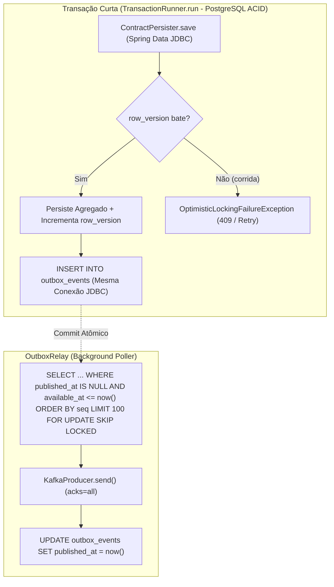

# 🗄️ LocaSign — Diagrama Entidade-Relacionamento (ER) e Engenharia de Banco de Dados

> **Especialidade:** Database Optimizer  
> **Motor Relacional:** PostgreSQL 18.6 (ACID, Isolamento `Read Committed` com Virtual Threads e HikariCP)  
> **Migrations Flyway:** `V1__create_locasign_schema.sql` e `V2__create_housekeeping_indexes.sql`  
> **Governança:** Regras R1–R10, ADR-002, ADR-003, ADR-011, ADR-013, ADR-015, ADR-017 e ADR-018

---

## 1. 📐 Diagrama Entidade-Relacionamento (ERD)

O diagrama abaixo modela todas as 9 tabelas do banco de dados relacional do LocaSign, os tipos de dados nativos exatos
do PostgreSQL 18.6, chaves primárias (`PK`), chaves estrangeiras (`FK`), unicidades (`UK`), cardinalidades formais e o
isolamento de fronteiras modulares.

```mermaid
erDiagram
%% ==========================================
%% MÓDULO LEASE (LOCAÇÕES)
%% ==========================================
    leases {
        uuid id PK "Identificador único da locação (UUIDv4)"
        text tenant_name "Nome completo do locatário"
        text tenant_cpf "CPF do locatário (dígitos normalizados)"
        text tenant_email "E-mail do locatário"
        text agency_signer_name "Nome do representante da imobiliária"
        text agency_signer_email "E-mail do representante da imobiliária"
        text property_address "Endereço completo do imóvel (até 300 char)"
        numeric rent_amount "Valor do aluguel (numeric 12,2 > 0)"
        date start_date "Data de início da vigência"
        integer term_months "Prazo da locação em meses (1 a 120)"
        text status "Status da locação: REGISTERED | ACTIVE"
        timestamptz activated_at "Data/hora da ativação pós-assinatura (R8)"
        bigint row_version "Controle de concorrência otimista (OCC)"
        timestamptz created_at "Data/hora de criação do registro (UTC)"
    }

%% ==========================================
%% MÓDULO CONTRACT (CONTRATOS E SIGNATÁRIOS)
%% ==========================================
    contracts {
        uuid id PK "Identificador único do contrato (UUIDv4)"
        uuid lease_id FK "Locação vinculada (FK leases.id)"
        integer version_number "Número da versão do contrato (>= 1, R9)"
        text status "Máquina de estados: DRAFT..COMPLETED (R5)"
        text provider_document_id UK "ID do documento na PandaDoc (UK)"
        timestamptz provider_last_modified_at "Data de modificação no provedor externo"
        timestamptz sent_at "Instante de envio para assinatura"
        timestamptz expires_at "Prazo limite para conclusão (7 dias, R4)"
        timestamptz reminder_sent_at "Instante de disparo do lembrete (3 dias, R4)"
        timestamptz last_reconciled_at "Última verificação ativa no provedor"
        text cancel_reason "Justificativa formal de cancelamento (R9)"
        text signed_document_ref "Referência do arquivo PDF arquivado"
        bigint row_version "Controle de concorrência otimista (OCC)"
        timestamptz created_at "Data/hora de confecção do rascunho (UTC)"
        timestamptz updated_at "Data/hora da última atualização de estado (UTC)"
    }

    contract_signers {
        uuid id PK "Identificador único do signatário"
        uuid contract_id FK "Contrato vinculado (FK contracts.id ON DELETE CASCADE)"
        text role "Papel no fluxo: TENANT | AGENCY"
        text name "Nome completo do signatário"
        text email "E-mail do signatário"
        integer signing_order "Ordem sequencial de assinatura (1=Locatário, 2=Imobiliária, R3)"
        timestamptz completed_at "Data/hora em que a assinatura foi concluída"
    }

    contract_status_history {
        bigint seq "Sequencial monotônico autoincrementado (Identity)"
        uuid id PK "Identificador único do registro de histórico"
        uuid contract_id FK "Contrato vinculado (FK contracts.id ON DELETE CASCADE)"
        text from_status "Status de origem (null na criação)"
        text to_status "Status de destino"
        text outcome "Resultado: APPLIED | IGNORED_TRANSITION | INFO"
        text source "Origem: API | WEBHOOK | RECONCILIATION | SCHEDULER"
        text source_event_id "ID de rastreabilidade ou correlação do evento"
        text note "Observação técnica ou motivo da transição"
        timestamptz occurred_at "Instante em que o evento ocorreu no domínio (UTC)"
    }

    post_signature_actions {
        uuid id PK "Identificador único da ação pós-assinatura"
        uuid contract_id FK "Contrato vinculado (FK contracts.id)"
        text action_type "Tipo de ação: ACTIVATE_LEASE | SCHEDULE_ENTRY_INSPECTION | REGISTER_FIRST_CHARGE"
        text status "Estado da execução: DONE | SIMULATED"
        timestamptz executed_at "Instante de execução (UTC)"
        jsonb details "Metadados técnicos e payload da execução"
    }

%% ==========================================
%% MÓDULO NOTIFICATION (NOTIFICAÇÕES)
%% ==========================================
    notifications_log {
        uuid id PK "Identificador único do registro de notificação"
        uuid contract_id "Referência lógica ao contrato (Desacoplamento Modular)"
        text event_id "Identificador do evento Kafka gerador da notificação"
        text event_type "Nome do evento: ContractSent, ContractCompleted, etc."
        text recipient_masked "Destinatário mascarado em conformidade com R10 LGPD"
        timestamptz created_at "Data/hora de registro da notificação (UTC)"
    }

%% ==========================================
%% MÓDULO SHARED (INFRAESTRUTURA TRANSVERSAL)
%% ==========================================
    webhook_inbox {
        uuid id PK "Identificador único da entrada no inbox"
        text delivery_id UK "Chave de deduplicação (Header PandaDoc ou SHA-256)"
        text raw_body "Payload bruto inalterado em bytes/texto (R7)"
        timestamptz received_at "Instante exato da recepção HTTP (UTC)"
    }

    outbox_events {
        bigint seq "Sequencial monotônico autoincrementado para fila (Identity)"
        text id PK "ID único do evento (UUID de domínio ou deliveryId:index, ADR-006)"
        text aggregate_type "Tipo do emissor: Contract | ProviderWebhook"
        text aggregate_id "ID do agregado ou documento em formato texto"
        text event_type "Nome do evento de domínio ou do webhook"
        text topic "Tópico de destino no Apache Kafka"
        text message_key "Chave de particionamento no Kafka"
        jsonb payload "Envelope estruturado do evento (correlationId, causationId, payload; R10)"
        jsonb headers "Headers Kafka: eventType, eventId, schemaVersion, correlationId"
        timestamptz created_at "Instante de gravação atômica na transação (UTC)"
        timestamptz published_at "Instante de confirmação de publicação pelo Relay"
        integer attempts "Contador de tentativas de entrega pelo Relay"
        text last_error "Detalhe do último erro de comunicação com o broker"
        timestamptz available_at "Instante a partir do qual o evento pode ser retransmitido"
    }

    processed_messages {
        text consumer_group PK "Grupo consumidor do Kafka (ex: locasign-orchestrator)"
        text event_id PK "ID único do evento processado (UUID ou deliveryId:index, R6)"
        timestamptz processed_at "Instante em que o processamento foi consolidado (UTC)"
    }

%% ==========================================
%% RELACIONAMENTOS E CARDINALIDADES FORMAIS
%% ==========================================
    leases ||--o{ contracts: "possui versões (1:N)"
    contracts ||--|{ contract_signers: "possui signatários (1:N, cascade)"
    contracts ||--|{ contract_status_history: "registra auditoria (1:N, cascade)"
    contracts ||--o{ post_signature_actions: "executa ações pós-assinatura (1:N)"
    contracts ||..o{ notifications_log: "referência lógica desacoplada (sem FK)"
```



---

## 2. 📚 Dicionário de Dados Detalhado por Módulo

### 2.1 Módulo `lease` (Locações Residenciais)

#### Tabela `leases`

Representa a raiz de agregação da locação residencial.

- **`id` (`uuid`, PK):** Identificador universal único gerado no domínio (`kotlin.uuid.Uuid`).
- **`tenant_name` (`text`, NOT NULL):** Nome completo do locatário principal.
- **`tenant_cpf` (`text`, NOT NULL):** CPF composto exclusivamente por 11 dígitos numéricos, validado por algoritmo de
  módulo 11 (Regra **R2**).
- **`tenant_email` (`text`, NOT NULL):** Endereço de e-mail do locatário.
- **`agency_signer_name` (`text`, NOT NULL):** Nome do representante legal da imobiliária.
- **`agency_signer_email` (`text`, NOT NULL):** E-mail funcional do representante da imobiliária.
- **`property_address` (`text`, NOT NULL):** Endereço completo do imóvel locado (limite de 300 caracteres).
- **`rent_amount` (`numeric(12, 2)`, NOT NULL):** Valor monetário do aluguel mensal. Restrição de integridade:
  `rent_amount > 0` (`ck_leases_rent_amount`).
- **`start_date` (`date`, NOT NULL):** Data de início do contrato. No cadastro, deve ser presente ou futura (`>= today`,
  Regra **R2**).
- **`term_months` (`integer`, NOT NULL):** Duração da locação em meses. Restrição de integridade:
  `term_months BETWEEN 1 AND 120` (`ck_leases_term_months`). Padrão de negócio: 30 meses.
- **`status` (`text`, NOT NULL, DEFAULT `'REGISTERED'`):** Estado da locação: `'REGISTERED'` (recém-cadastrada) ou
  `'ACTIVE'` (ativada após conclusão do contrato). Restrição: `ck_leases_status`.
- **`activated_at` (`timestamptz`, NULL):** Timestamp UTC em que a locação transitou para `'ACTIVE'` disparada pelas
  ações pós-assinatura (Regra **R8**).
- **`row_version` (`bigint`, NOT NULL):** Versão do registro para controle de concorrência otimista (OCC) via Spring
  Data JDBC (`@Version`).
- **`created_at` (`timestamptz`, NOT NULL):** Timestamp UTC de cadastro da locação.

---

### 2.2 Módulo `contract` (Contratos, Assinaturas e Auditoria)

#### Tabela `contracts`

Representa o agregado raiz do contrato de locação e sua máquina de estados.

- **`id` (`uuid`, PK):** Identificador do contrato (`ContractId`).
- **`lease_id` (`uuid`, NOT NULL, FK `leases.id`):** Chave estrangeira referenciando a locação proprietária.
- **`version_number` (`integer`, NOT NULL):** Número incremental da versão (v1, v2, v3). Restrição:
  `version_number >= 1` (`ck_contracts_version`). Unicidade por locação: `UNIQUE (lease_id, version_number)`
  (`uq_contracts_lease_version`).
- **`status` (`text`, NOT NULL):** Estado atual na máquina de estados determinística (`ContractTransitionPolicy`, Regra
  **R5**). Valores permitidos: `'DRAFT'`, `'GENERATED'`, `'SENT'`, `'VIEWED'`, `'PARTIALLY_SIGNED'`, `'COMPLETED'`,
  `'DECLINED'`, `'EXPIRED'`, `'CANCELLED'` (`ck_contracts_status`).
- **`provider_document_id` (`text`, NULL, UNIQUE):** Identificador do documento criado na PandaDoc
  (`uq_contracts_provider_document`).
- **`provider_last_modified_at` (`timestamptz`, NULL):** Carimbo de data/hora da última alteração no provedor para
  resolução de entregas assíncronas fora de ordem.
- **`sent_at` (`timestamptz`, NULL):** Timestamp UTC de envio formal para assinatura eletrônica.
- **`expires_at` (`timestamptz`, NULL):** Timestamp UTC de expiração do contrato (Regra **R4**: 7 dias após `sent_at`).
- **`reminder_sent_at` (`timestamptz`, NULL):** Timestamp UTC de envio do lembrete automático (Regra **R4**: 3 dias após
  `sent_at`).
- **`last_reconciled_at` (`timestamptz`, NULL):** Timestamp UTC da última checagem ativa de estado via job ou API de
  operador (ADR-017 / ADR-018).
- **`cancel_reason` (`text`, NULL):** Justificativa formal obrigatória em caso de cancelamento manual ou falha
  definitiva (Regra **R9**).
- **`signed_document_ref` (`text`, NULL):** Identificador de armazenamento do PDF assinado baixado.
- **`row_version` (`bigint`, NOT NULL):** Lock otimista (OCC). Conflitos geram `OptimisticLockingFailureException` (HTTP
  409).
- **`created_at` (`timestamptz`, NOT NULL):** Criação do rascunho em UTC.
- **`updated_at` (`timestamptz`, NOT NULL):** Última modificação de estado em UTC.

#### Tabela `contract_signers`

Coleção filha de partes assinantes do contrato (mapeada com `@MappedCollection`).

- **`id` (`uuid`, PK, DEFAULT `gen_random_uuid()`):** Identificador único da linha.
- **`contract_id` (`uuid`, NOT NULL, FK `contracts.id` ON DELETE CASCADE):** Vínculo ao contrato pai.
- **`role` (`text`, NOT NULL):** Papel de assinatura: `'TENANT'` (Locatário) ou `'AGENCY'` (Imobiliária)
  (`ck_contract_signers_role`). Unicidade: `UNIQUE (contract_id, role)` (`uq_contract_signers_role`).
- **`name` (`text`, NOT NULL):** Nome completo do signatário.
- **`email` (`text`, NOT NULL):** E-mail para recebimento do link de assinatura.
- **`signing_order` (`integer`, NOT NULL):** Ordem sequencial de assinatura (Regra **R3**: 1 para `TENANT`, 2 para
  `AGENCY`). Restrição: `signing_order >= 1` (`ck_contract_signers_order`).
- **`completed_at` (`timestamptz`, NULL):** Timestamp UTC no qual o signatário concluiu sua assinatura eletrônica.

#### Tabela `contract_status_history`

Trilha imutável de auditoria de eventos e transições de estado do contrato.

- **`seq` (`bigint`, IDENTITY):** Sequencial monotônico autoincrementado para ordenação temporal absoluta.
- **`id` (`uuid`, PK):** Identificador único da linha de auditoria.
- **`contract_id` (`uuid`, NOT NULL, FK `contracts.id` ON DELETE CASCADE):** Contrato auditado.
- **`from_status` (`text`, NULL):** Status anterior à transição (nulo apenas no evento de criação inicial).
- **`to_status` (`text`, NOT NULL):** Novo status do contrato.
- **`outcome` (`text`, NOT NULL):** Resultado da operação: `'APPLIED'` (transição efetivada), `'IGNORED_TRANSITION'`
  (evento tardio, repetido ou inconsistente ignorado com base na Regra **R5**) ou `'INFO'` (registro de fato
  informativo, como assinatura individual) (`ck_history_outcome`).
- **`source` (`text`, NOT NULL):** Canal de origem: `'API'`, `'WEBHOOK'`, `'RECONCILIATION'`, `'SCHEDULER'`
  (`ck_history_source`).
- **`source_event_id` (`text`, NULL):** Identificador de rastreabilidade (Correlation ID, Event ID do Kafka ou Delivery
  ID do Webhook).
- **`note` (`text`, NULL):** Justificativa, texto de anomalia ou detalhe da operação.
- **`occurred_at` (`timestamptz`, NOT NULL):** Timestamp UTC em que a ocorrência se materializou.

#### Tabela `post_signature_actions`

Registro de controle de efeitos colaterais pós-assinatura (Regras **R6** e **R8**).

- **`id` (`uuid`, PK, DEFAULT `gen_random_uuid()`):** Identificador único do registro.
- **`contract_id` (`uuid`, NOT NULL, FK `contracts.id`):** Contrato concluído que disparou a ação.
- **`action_type` (`text`, NOT NULL):** Tipo da ação executada: `'ACTIVATE_LEASE'`, `'SCHEDULE_ENTRY_INSPECTION'` ou
  `'REGISTER_FIRST_CHARGE'`.
- **`status` (`text`, NOT NULL):** Estado da ação (`'DONE'` para ativação real ou `'SIMULATED'` para integrações
  simuladas).
- **`executed_at` (`timestamptz`, NOT NULL, DEFAULT `now()`):** Instante de execução UTC.
- **`details` (`jsonb`, NULL):** Carga estruturada com detalhes da operação (datas, valores, protocolos).
- **Unicidade Estrita:** `UNIQUE (contract_id, action_type)` (`uq_post_signature_action`), assegurando semântica
  *at-most-once* por ação por contrato.

---

### 2.3 Módulo `notification` (Auditoria de Notificações)

#### Tabela `notifications_log`

Trilha de auditoria das notificações geradas e simuladas pelo sistema.

- **`id` (`uuid`, PK, DEFAULT `gen_random_uuid()`):** Identificador do log.
- **`contract_id` (`uuid`, NOT NULL):** Referência lógica ao contrato. **Nota do Database Optimizer:** esta tabela *não*
  declara Foreign Key relacional para `contracts(id)`, preservando o isolamento de escrita do bounded context de
  notificações. Na leitura, o adaptador `JdbcNotificationRecipientsAdapter` executa uma projeção somente leitura
  autorizada pelo **ADR-018** sobre `contract_signers` para resolver e mascarar os destinatários.
- **`event_id` (`text`, NOT NULL):** UUID da mensagem Kafka consumida.
- **`event_type` (`text`, NOT NULL):** Tipo de evento de contrato (`ContractSent`, `ContractCompleted`, etc.).
- **`recipient_masked` (`text`, NOT NULL):** Endereço de e-mail estritamente mascarado via `Email.masked()` (Regra
  **R10** — LGPD).
- **`created_at` (`timestamptz`, NOT NULL, DEFAULT `now()`):** Instante de emissão da notificação em UTC.

---

### 2.4 Módulo `shared` (Padrões Transversais de Mensageria e Concorrência)

#### Tabela `webhook_inbox`

Implementação do padrão *Transactional Inbox* para recepção de webhooks externos (Regra **R7**).

- **`id` (`uuid`, PK, DEFAULT `gen_random_uuid()`):** Identificador do item de inbox.
- **`delivery_id` (`text`, NOT NULL, UNIQUE):** Identificador da entrega (`X-PandaDoc-Webhook-Event-Id` ou hash SHA-256
  do corpo bruto). Unicidade: `uq_webhook_inbox_delivery`.
- **`raw_body` (`text`, NOT NULL):** Corpo bruto da requisição exatamente como entregue na rede. **Decisão crítica:**
  armazenado como `TEXT` (e não `JSONB`) para garantir que a resserialização não altere espaços, quebras de linha ou
  ordem de chaves, permitindo revalidação matemática determinística do HMAC-SHA256 em auditorias.
- **`received_at` (`timestamptz`, NOT NULL, DEFAULT `now()`):** Carimbo UTC de recepção da entrega HTTP.

#### Tabela `outbox_events`

Implementação do padrão *Transactional Outbox* para publicação atômica no Apache Kafka.

- **`seq` (`bigint`, IDENTITY):** Sequencial monotônico estritamente crescente para processamento em fila FIFO no relay.
- **`id` (`text`, PK):** Identificador único do evento em formato textual (UUID para eventos de domínio de contrato, ou
  chave composta `deliveryId:index` para itens de webhook conforme **ADR-006**).
- **`aggregate_type` (`text`, NOT NULL):** Tipo do emissor (`Contract` em `OutboxContractEventPublisher` ou
  `ProviderWebhook` em `ReceiveProviderWebhook`).
- **`aggregate_id` (`text`, NOT NULL):** Identificador textual do contrato ou do documento da PandaDoc.
- **`event_type` (`text`, NOT NULL):** Nome simples da classe do evento de domínio (`ContractRequested`,
  `ContractCompleted`, etc.) ou nome do evento de webhook (`document_state_changed`, `recipient_completed`).
- **`topic` (`text`, NOT NULL):** Tópico do Kafka de destino (`locasign.contract.events.v1`,
  `locasign.pandadoc.webhooks.v1`).
- **`message_key` (`text`, NOT NULL):** Chave de particionamento do Kafka (mantém ordem determinística por
  contrato/documento dentro da partição).
- **`payload` (`jsonb`, NOT NULL):** Envelope JSONB serializado contendo metadados (`eventId`, `eventType`,
  `schemaVersion`, `occurredAt`, `aggregateType`, `aggregateId`, `correlationId`, `causationId`) e o objeto `payload`
  (sem PII aberta nos eventos de domínio, Regra **R10**).
- **`headers` (`jsonb`, NOT NULL, DEFAULT `'{}'::jsonb`):** Headers Kafka serializados (`eventType`, `eventId`,
  `schemaVersion`, `correlationId`).
- **`created_at` (`timestamptz`, NOT NULL, DEFAULT `now()`):** Timestamp UTC de inserção atômica na transação.
- **`published_at` (`timestamptz`, NULL):** Timestamp UTC em que o `OutboxRelay` recebeu `ACK` de publicação do broker
  Kafka. Nulo enquanto o evento estiver pendente na fila.
- **`attempts` (`integer`, NOT NULL, DEFAULT `0`):** Quantidade de tentativas de envio executadas.
- **`last_error` (`text`, NULL):** Detalhes da última exceção de rede/transporte com o Kafka.
- **`available_at` (`timestamptz`, NOT NULL, DEFAULT `now()`):** Carimbo UTC a partir do qual a mensagem está apta para
  retransmissão após backoff exponencial.

#### Tabela `processed_messages`

Tabela de deduplicação idempotente de mensagens consumidas do Kafka (Regra **R6**).

- **`consumer_group` (`text`, NOT NULL):** Nome do grupo consumidor (`locasign-orchestrator`, `locasign-post-signature`,
  `locasign-notifications`, `locasign-pandadoc-webhooks`).
- **`event_id` (`text`, NOT NULL):** Identificador único do evento consumido (tipado como `text` para suportar tanto
  UUIDs de eventos de domínio quanto chaves compostas `deliveryId:index` de webhooks).
- **`processed_at` (`timestamptz`, NOT NULL, DEFAULT `now()`):** Timestamp UTC de conclusão do processamento.
- **Chave Primária Composta:** `PRIMARY KEY (consumer_group, event_id)`, impedindo computação duplicada sob repetições
  de entrega de rede no Kafka (*at-least-once*).

---

## 3. ⚡ Dossiê de Indexação e Otimização de Performance

### 3.1 Índices Parciais Críticos e Salvaguardas de Regras de Negócio

| Índice                                  | Tabela / Colunas               | Condição (`WHERE`)                                                | Propósito de Engenharia e Regra                                                                                                                                                                                                                                                                                                                                                   |
|-----------------------------------------|--------------------------------|-------------------------------------------------------------------|-----------------------------------------------------------------------------------------------------------------------------------------------------------------------------------------------------------------------------------------------------------------------------------------------------------------------------------------------------------------------------------|
| **`ux_contracts_one_active_per_lease`** | `contracts (lease_id)`         | `status NOT IN ('COMPLETED', 'DECLINED', 'EXPIRED', 'CANCELLED')` | **Regra R1:** Impede concorrencialmente que uma locação possua mais de um contrato em estado não terminal. Por ser parcial, exclui contratos finais da árvore B-Tree, consumindo fração mínima de espaço em disco e bloqueando colisões no próprio motor ACID sem necessidade de locks distribuídos. Violações são capturadas pelo adapter e devolvidas como `HTTP 409 Conflict`. |
| **`ix_contracts_open_by_expiry`**       | `contracts (expires_at)`       | `status IN ('SENT', 'VIEWED', 'PARTIALLY_SIGNED')`                | **Regra R4:** Apoio de altíssima performance para o job agendado de expiração (`ExpirationJob`). O scan busca apenas contratos abertos cujo prazo expirou (`expires_at <= :now`), ignorando dezenas de milhares de contratos concluídos ou cancelados.                                                                                                                            |
| **`ix_contracts_open_by_update`**       | `contracts (updated_at)`       | `status NOT IN ('COMPLETED', 'DECLINED', 'EXPIRED', 'CANCELLED')` | **ADR-017 / Reconciliação:** Permite que `findReconciliationCandidates` ordene e pagine contratos estagnados (`updated_at <= :staleBefore`) usando diretamente o índice em `updated_at`, sem incorrer em scans sequenciais em tabelas grandes.                                                                                                                                    |
| **`ix_outbox_pending`**                 | `outbox_events (seq)`          | `published_at IS NULL`                                            | **Relay & Telemetria:** Índice parcial compacto. Permite que o `OutboxRelay` varra lotes pendentes em ordem estrita de inserção com `FOR UPDATE SKIP LOCKED` e que o Micrometer calcule a latência do evento mais antigo (`created_at`) em **$O(1)$ (< 0,03 ms)** via consulta `ORDER BY seq LIMIT 1`.                                                                            |
| **`ix_outbox_published`** *(V2)*        | `outbox_events (published_at)` | `published_at IS NOT NULL`                                        | **Housekeeping (ADR-017):** Otimiza o `DELETE` diário de retenção (30 dias). Por ser parcial, exclui linhas pendentes, garantindo que o índice não sofra degradação em backlogs de indisponibilidade de broker.                                                                                                                                                                   |

### 3.2 Índices B-Tree Tradicionais e Índices Implícitos de Unicidade (`UNIQUE`)

| Índice / Constraint                             | Tabela / Colunas                              | Finalidade Operacional                                                                                                                                                                                                                                                   |
|-------------------------------------------------|-----------------------------------------------|--------------------------------------------------------------------------------------------------------------------------------------------------------------------------------------------------------------------------------------------------------------------------|
| **`uq_contracts_lease_version`** *(UNIQUE)*     | `contracts (lease_id, version_number)`        | Garante unicidade da versão (Regra **R9**) e acelera por *Index Scan Backward* tanto a projeção CQRS `LEFT JOIN LATERAL (... ORDER BY version_number DESC LIMIT 1)` em `LeaseQueryAdapter` (**ADR-018**) quanto o cálculo de `MAX(version_number)` em `RequestContract`. |
| **`uq_contract_signers_role`** *(UNIQUE)*       | `contract_signers (contract_id, role)`        | Impede papéis duplicados no mesmo contrato e serve de índice de prefixo (`contract_id`) para hidratação do agregado e para a projeção somente leitura de `JdbcNotificationRecipientsAdapter` (**ADR-018**).                                                              |
| **`uq_contracts_provider_document`** *(UNIQUE)* | `contracts (provider_document_id)`            | Busca em $O(\log N)$ do contrato a partir do `documentId` recebido em webhooks da PandaDoc (`findByProviderDocumentId`).                                                                                                                                                 |
| **`ix_history_contract`**                       | `contract_status_history (contract_id, seq)`  | Garante leitura instantânea da linha do tempo do contrato no endpoint `GET /api/v1/contracts/{id}/history` ordenada por `seq` (**ADR-018**).                                                                                                                             |
| **`ix_notifications_contract`**                 | `notifications_log (contract_id, created_at)` | Apoio a consultas de auditoria de notificações enviadas por contrato ao longo do tempo.                                                                                                                                                                                  |
| **`ix_inbox_received`** *(V2)*                  | `webhook_inbox (received_at)`                 | Permite ao `HousekeepingJob` apagar entregas de webhook antigas (`received_at < :cutoff`) sem realizar `Seq Scan` em tabelas de centenas de milhares de linhas.                                                                                                          |
| **`ix_processed_at`** *(V2)*                    | `processed_messages (processed_at)`           | Permite ao `HousekeepingJob` expurgar registros de idempotência consumidos há mais de 30 dias com custo proporcional às linhas deletadas.                                                                                                                                |

---

## 4. 🛡️ Concorrência, Transações e Bloqueios



1. **Controle de Concorrência Otimista (OCC):**
    - As tabelas principais de escrita (`leases` e `contracts`) implementam a coluna `row_version bigint NOT NULL`.
    - No `INSERT`, o Spring Data JDBC grava a versão inicial. A cada `UPDATE`, a cláusula
      `WHERE id = :id AND row_version = :old_version` é disparada.
    - Caso outra thread ou consumidor concorrente tenha alterado o registro, zero linhas são atualizadas e uma
      `OptimisticLockingFailureException` é lançada, sendo capturada e tratada com semântica de conflito
      (`HTTP 409 Conflict`) ou retentada automaticamente no consumidor Kafka.
2. **Atomicidade Agregado + Outbox:**
    - O use case executa dentro do bloco `TransactionRunner.run { }` (ADR-011).
    - A mutação da entidade e a inserção do evento na tabela `outbox_events` compartilham a mesma transação relacional
      JDBC (`Connection`).
    - Se a gravação do outbox falhar, o agregado sofre rollback; se o agregado falhar, nenhum evento órfão é registrado.
3. **Resiliência e Ausência de Locks Bloqueantes no OutboxRelay (ADR-017):**
    - O `OutboxRelay` utiliza `FOR UPDATE SKIP LOCKED` para consumir lotes sem bloquear threads simultâneas.
    - Em caso de falha de conexão com o broker Kafka (`TimeoutException`), o relay interrompe o lote imediatamente na
      primeira falha, liberando locks e a conexão do pool HikariCP (evitando a retenção de locks de banco por mais de 16
      minutos).

---

## 5. ⚙️ Recomendações de Otimização e Parâmetros para PostgreSQL 18.6 em Produção

Para ambientes sob carga elevada com virtual threads e pools de conexões enxutos:

```ini
# ==============================================================================
# Parâmetros de Performance Recomendados para o PostgreSQL 18.6
# ==============================================================================

# Conexões e Pool (HikariCP dimensionado com maximum-pool-size: 10 por instância)
max_connections = 100
superuser_reserved_connections = 3

# Memória (Base calculada para nó de 16 GB RAM dedicado)
shared_buffers = 4GB
work_mem = 32MB
maintenance_work_mem = 512MB
effective_cache_size = 12GB

# Write-Ahead Logging (WAL) e Checkpoints
wal_buffers = 16MB
min_wal_size = 1GB
max_wal_size = 8GB
checkpoint_completion_target = 0.9

# Otimizador de Consultas
random_page_cost = 1.1          # Storage SSD NVMe
effective_io_concurrency = 200  # SSD NVMe

# Autovacuum Agressivo para Tabelas de Alto Churn (outbox_events, webhook_inbox)
autovacuum = on
autovacuum_max_workers = 4
autovacuum_naptime = 15s
autovacuum_vacuum_threshold = 50
autovacuum_vacuum_scale_factor = 0.05
autovacuum_analyze_scale_factor = 0.02

# Reserva de espaço na página de heap para updates locais e HOT updates
ALTER TABLE contracts SET (fillfactor = 85);
ALTER TABLE outbox_events SET (fillfactor = 90);
```

> **Nota técnica sobre `fillfactor` e HOT (Heap-Only Tuple) Updates no PostgreSQL:**
> No PostgreSQL, um `UPDATE` só se qualifica como **HOT update** (sem inserção de novas entradas nas árvores B-Tree)
> quando há espaço livre na mesma página de 8 KB **e nenhuma coluna referenciada por qualquer índice da tabela (
incluindo
colunas na cláusula `WHERE` de índices parciais) é modificada**:
> - **Em `contracts`:** Transições de status via `ContractPersister.save` alteram `status` (presente no predicado
    `WHERE` de 3 índices parciais) e `updated_at` (chave de `ix_contracts_open_by_update`), portanto exigem manutenção
    de índices — mas o `fillfactor = 85` mantém a nova tupla na mesma página física de 8 KB, reduzindo saltos de I/O
    aleatório. Já a operação `markReconciled` (`UPDATE contracts SET last_reconciled_at = :at WHERE id = :id`,
    **ADR-017**) altera exclusivamente `last_reconciled_at` (coluna não indexada) sem tocar em `updated_at` ou `status`,
    executando como **HOT update puro**.
> - **Em `outbox_events`:** Em cenários de falha transitória de entrega (`OutboxRelay.markFailed`), o `UPDATE` modifica
    apenas `attempts`, `last_error` e `available_at` (nenhuma delas presente em `ix_outbox_pending` ou
    `ix_outbox_published`), permitindo que retentativas ocorram via **HOT update** com `fillfactor = 90`.

